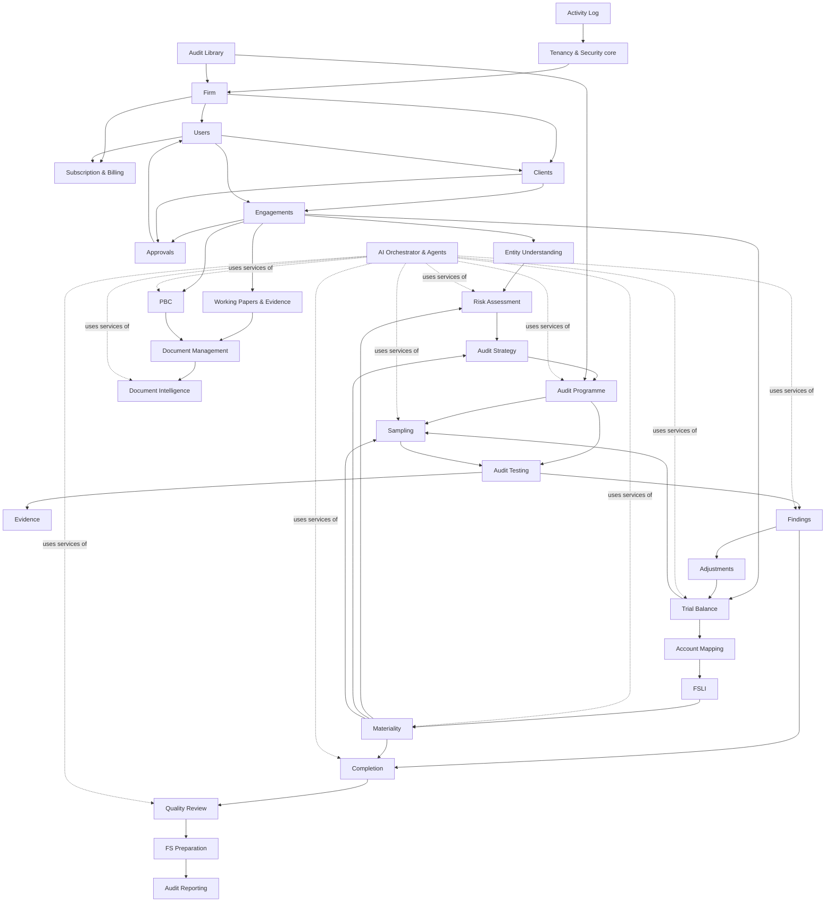

# AUDIRA — System Architecture

Status: **Approved baseline (Phase 0); implemented through Phase 10** · Last updated: 2026-11-22

## 1. Architectural style

AUDIRA is a **modular monolith** built on Laravel 12 (PHP 8.3+), backed by PostgreSQL 16 and Redis.
A monolith is the right shape for a small team building a regulated, transaction-heavy product:
one deployable unit, one database transaction boundary, one permission system. Modules are
separated by namespace, service classes and explicit dependencies (section 4), so any module
that later needs to scale independently (e.g. Document Intelligence workers) can be split out
without rewriting the domain.

```
                      ┌─────────────────────────────────────────────┐
  Browser (Blade +    │                LARAVEL APP                  │
  Alpine + Tailwind)  │  ┌──────────┐ ┌───────────┐ ┌────────────┐  │
  ───── HTTPS ───────▶│  │ Web (UI) │ │ REST API  │ │ Client     │  │
                      │  │ routes   │ │ /api/v1   │ │ Portal     │  │
  Client portal ─────▶│  └────┬─────┘ └─────┬─────┘ └─────┬──────┘  │
                      │       ▼             ▼             ▼         │
                      │  Middleware: auth · SetTenantContext ·      │
                      │  EnsureFirmActive · throttle · policies     │
                      │       ▼                                     │
                      │  Domain services (per module)               │
                      │       ▼                                     │
                      │  Eloquent models + FirmScope (app layer)    │
                      └───────┬───────────────┬──────────────┬──────┘
                              ▼               ▼              ▼
                  PostgreSQL 16 (+RLS,  Redis (queues,  Private S3-compatible
                  pgvector in prod)     cache, locks,   object storage
                                        rate limits)    (documents/evidence)
                              ▲               │
                              │               ▼
                      ┌───────┴──────────────────────────────┐
                      │ Queue workers (Laravel Queues)       │
                      │  • AI Orchestrator + agent jobs      │
                      │  • Document parsing / OCR / scanning │
                      │  • Notifications, exports            │
                      │ Scheduler: monitoring, billing runs, │
                      │  retention, backups verification     │
                      └───────┬──────────────────────────────┘
                              ▼
                      LLM Gateway (provider-independent)
                      → Anthropic / OpenAI / Azure / local models
```

## 2. Layers

| Layer | Responsibility | Laravel construct |
|---|---|---|
| Presentation | Blade views, Alpine components, Tailwind design system | `resources/views`, `resources/js`, Blade components |
| HTTP | Routing, validation, authorisation, response shaping | Controllers, FormRequests, Policies, Middleware |
| Application | Use-case orchestration, transactions, events, approvals | `app/Services/<Module>` |
| Domain | Entities, enums, invariants | `app/Models`, `app/Enums` |
| Tenancy & security | Tenant context, scopes, RLS session variables | `app/Support/Tenancy` |
| AI | Gateway, orchestrator, agents, tools, guardrails | `app/Ai` (Phase 4) |
| Infrastructure | DB, queues, storage, mail, LLM providers | config + drivers |

Rules:
- Controllers stay thin: validate (FormRequest) → authorise (Policy) → call a Service → return view/JSON.
- Every state-changing service call writes an **activity log** entry in the same DB transaction.
- Every decision that the CLAUDE.md lists as requiring human approval goes through the **Approval** service. No module flips an "approved" flag directly.
- The web UI and the REST API share the same services, so behaviour cannot diverge.

## 3. Module catalogue (27 mandatory modules)

| # | Module | Phase | Key entities |
|---|---|---|---|
| 1 | Firm Management | 1 | firms, firm settings |
| 2 | User Management | 1 | users, invitations, firm roles |
| 3 | Client Management | 1 | clients, client_contacts, client acceptance |
| 4 | Engagement Management | 1 | engagements, engagement_members |
| 5 | Audit Library | 2 | frameworks, standards, standard_versions, library_sources |
| 6 | Entity Understanding | 2 | entity_profiles, understanding_sections |
| 7 | Trial Balance Import | 3 | tb_imports, tb_lines |
| 8 | Account Mapping | 3 | account_mappings, mapping_templates |
| 9 | FSLI Management | 3 | fslis, fsli_templates, lead_schedules |
| 10 | Materiality | 5 | materiality_assessments, materiality_versions |
| 11 | Risk Assessment | 5 | risks, risk_assertions, controls |
| 12 | Audit Strategy | 5 | audit_strategies |
| 13 | Audit Programme | 6 | programmes, procedures |
| 14 | Audit Sampling | 6 | populations, sampling_plans, sample_items, selection_logs |
| 15 | PBC Management | 7 | pbc_requests, pbc_items |
| 16 | Document Intelligence | 7 | documents, document_extractions |
| 17 | Audit Testing | 8 | tests, test_results |
| 18 | Evidence Management | 2/8 | evidence, evidence_links |
| 19 | Audit Findings | 8 | findings |
| 20 | Audit Adjustments | 3/8 | adjustments, adjustment_lines |
| 21 | Working Paper Management | 2 | working_papers, wp_signoffs, review_notes |
| 22 | Audit Completion | 9 | completion_checklists, subsequent_events |
| 23 | Quality Review | 9 | quality_reviews (EQR), review_notes |
| 24 | FS Preparation | 9 | fs_templates, fs_drafts |
| 25 | Audit Reporting | 9 | audit_reports, opinions, signoffs |
| 26 | Subscription & Billing | 1/10 | plans, subscriptions, invoices, usage |
| 27 | Superadmin Dashboard | 1/10 | platform metrics |
| — | Cross-cutting: Approvals, Activity Log, AI Usage, Notifications | 1/4 | approvals, activity_logs, ai_runs |

## 4. Module dependency map

Arrows read "depends on". No module may depend on a module below it in this graph
(enforced by review; an architecture test is planned in Phase 2).



AI agents never read tables directly. They call **tools**, which are thin wrappers around the
same module services the UI uses, executed inside the tenant + engagement scope of the run
(see `docs/AI_AGENTS.md`).

## 5. Multi-tenancy (summary — detail in SECURITY.md)

- Shared database, shared schema, `firm_id` on every tenant-owned row.
- **Layer 1 — application:** `TenantContext` singleton + `BelongsToFirm` trait adds a global
  `FirmScope` and auto-fills `firm_id` on create; cross-tenant writes throw.
- **Layer 2 — database:** PostgreSQL Row-Level Security policies keyed on the session
  variable `app.firm_id`, set by middleware for every request and by job middleware for every
  queued job. The application connects as a non-superuser role without `BYPASSRLS`.
- **Layer 3 — authorisation:** policies check firm role *and* engagement membership.

## 6. Request lifecycle

1. `auth` → `SetTenantContext` (resolve firm from user; set PHP context + `set_config('app.firm_id')`)
2. `EnsureFirmIsActive` (suspended / unpaid firms are read-only or blocked)
3. FormRequest validation → Policy authorisation (`can:` / `$this->authorize`)
4. Service executes inside `DB::transaction`, writes activity log, dispatches events
5. Response; middleware resets tenant context on terminate (safe for Octane / long-running workers)

## 7. Background processing

- Redis-backed Laravel Queues with named queues: `default`, `ai`, `documents`, `notifications`.
- Every job carrying tenant data implements `TenantAware` and is wrapped by job middleware that
  restores tenant context and RLS variable before `handle()`.
- Scheduler (implemented, `routes/console.php`): `audira:monitor` daily 07:00 MYT (engagement health rules → alerts + mail to partner/manager) and `audira:billing-run` daily 02:00 MYT (invoices for ended periods, past-due flagging). Planned: retention jobs, backup verification.

## 8. Storage

- Private S3-compatible bucket (AWS S3 ap-southeast-5 Malaysia region, or Wasabi/MinIO).
- Object keys: `firms/{firm_uuid}/engagements/{engagement_uuid}/{document_uuid}/{version}`.
- Downloads only via short-lived signed URLs issued after a policy check; no public ACLs.
- Uploads: size/type allow-list, MIME sniffing, antivirus scan (ClamAV) before the file is
  usable by humans or AI; hash (SHA-256) stored for evidence integrity.

## 9. Proposed folder structure

```
audira/
├── app/
│   ├── Ai/                         # Phase 4 (implemented)
│   │   ├── Gateway/                # LlmClient interface, Anthropic + OpenAI drivers, ModelRouter
│   │   ├── Runtime/                # AiOrchestrator, AgentRuntime, AiBudget, AiSettingsService
│   │   ├── Agents/                 # Agent base, AgentRegistry, one class per agent
│   │   ├── Tools/                  # permission-checked, engagement-scoped tools over services
│   │   ├── Rag/                    # LibraryRetriever (full-text + optional pgvector), EmbeddingClient
│   │   └── Guardrails/             # JSON schema validation; citation and figure checks live in agents
│   ├── Enums/                      # FirmRole, EngagementRole, EngagementStatus, ...
│   ├── Http/
│   │   ├── Controllers/{Auth,Firm,Users,Clients,Engagements,Approvals,Admin,Api/V1}/
│   │   ├── Middleware/             # SetTenantContext, EnsureFirmIsActive, EnsureSuperadmin
│   │   └── Requests/<Module>/
│   ├── Models/
│   ├── Policies/
│   ├── Services/<Module>/          # business logic, one folder per module (e.g. Planning/: Materiality, Risk, Strategy, PlanningPapers)
│   ├── Support/
│   │   ├── Tenancy/                # TenantContext, FirmScope, BelongsToFirm
│   │   └── Audit/                  # ActivityLogger
│   └── View/Components/
├── config/audira.php               # roles → permissions matrix, approval rules, limits
├── database/{migrations,factories,seeders}/
├── docs/                           # ARCHITECTURE, DATABASE, AI_AGENTS, ... (this folder)
├── resources/
│   ├── css/app.css                 # Tailwind entry + design tokens
│   ├── js/app.js                   # Alpine bootstrap
│   └── views/{layouts,components,auth,dashboard,firm,users,clients,engagements,approvals,admin}/
├── routes/{web.php,api.php,console.php}
└── tests/{Feature,Unit}/
```

## 10. Technology decisions

See `docs/DECISIONS.md`. The stack is exactly the one specified in CLAUDE.md §10; no change
is proposed. pgvector is recommended in production for hybrid library retrieval (full-text search works without it) — see ROADMAP.md.
