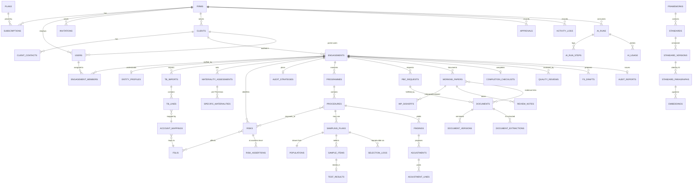

# AUDIRA — Database Design

Engine: **PostgreSQL 16** (pgvector extension required from Phase 5 for RAG; `pgcrypto`/`citext` available).
All money stored as **integer sen** (`bigint`, RM × 100) with an explicit currency column — never floats.
Every tenant-owned table carries `firm_id` (FK → firms, indexed) and is protected by Row-Level Security.

## 1. Conventions

| Convention | Rule |
|---|---|
| Primary keys | `bigint` identity internally; `uuid` column on externally referenced entities (URLs, storage keys, API) |
| Tenancy | `firm_id bigint not null` + RLS policy `tenant_isolation` (see SECURITY.md) |
| Soft deletes | Only on master data (firms, clients, engagements). Audit evidence is **never** hard-deleted |
| Timestamps | `timestamptz`, stored UTC, displayed Asia/Kuala_Lumpur |
| Enums | `varchar` + PHP backed enums + `CHECK` constraints for core states |
| JSON | `jsonb` only for snapshots/metadata, never for data that needs relational integrity |
| Audit trail | `activity_logs` is append-only, enforced by a DB trigger |
| Approval history | Never overwritten — each decision is a row in `approvals` |

## 2. Target ERD (all phases)



Approvals attach polymorphically (`approvable_type`, `approvable_id`) to clients, materiality
assessments, risks, sampling plans, adjustments, findings, completion checklists and audit reports.

## 3. Phase 1 schema (implemented)

### plans *(platform-level, no firm_id)*
| column | type | notes |
|---|---|---|
| id | bigint PK | |
| code | varchar unique | `starter`, `standard`, `professional` |
| name | varchar | |
| price_per_user_sen | integer | RM15 = 1500. Editable by Superadmin |
| currency | char(3) | `MYR` |
| min_paid_users | smallint | default 3 |
| max_users | smallint null | null = unlimited |
| ai_credits_per_user | integer | monthly AI allowance (Phase 4 metering) |
| features | jsonb | feature flags per plan |
| is_active / sort_order | | |

### firms
`id, uuid, name, slug (unique), registration_no (SSM), audit_firm_no (MIA AF no.), email, phone,
address_line1, address_line2, city, state, postcode, country (default MY), default_framework,
status [trial|active|suspended|cancelled], trial_ends_at, suspended_reason, timestamps, deleted_at`

### subscriptions
`id, firm_id, plan_id, status [trialing|active|past_due|cancelled], price_per_user_sen (snapshot),
min_paid_users (snapshot), current_period_start, current_period_end, cancelled_at, timestamps`
— price snapshot means a Superadmin price change applies from the next period, never retroactively.

### users
`id, uuid, firm_id null, client_id null, type [platform|firm|client], firm_role null
[firm_admin|partner|manager|senior|associate], name, email (unique, case-insensitive), password,
status [active|invited|deactivated], last_login_at, email_verified_at, remember_token, timestamps`
- `type=platform` → Superadmin, `firm_id` null.
- `type=client` → free client-portal user, `client_id` required, never billed.
- CHECK constraints enforce these combinations.

### invitations
`id, firm_id, email, firm_role, token_hash (sha256), invited_by, expires_at, accepted_at, revoked_at`

### clients
`id, uuid, firm_id, name, registration_no, entity_type [private_company|public_company|llp|jmb_mc|
cooperative|society|sole_prop_partnership|other], reporting_framework [mfrs|mpers|mpsas|other],
industry, fye_month, fye_day, email, phone, address, status [prospect|pending_acceptance|accepted|
declined|inactive], acceptance_risk [low|medium|high], independence_confirmed, acceptance_notes,
accepted_at, created_by, timestamps, deleted_at` — unique (firm_id, registration_no).

### client_contacts
`id, firm_id, client_id, name, position, email, phone, is_primary`

### engagements
`id, uuid, firm_id, client_id, code (unique per firm), name, engagement_type [statutory_audit|
special_purpose|review|agreed_upon_procedures], reporting_framework, period_start, period_end,
reporting_deadline, status [planning|fieldwork|completion|reporting|signed_off|archived],
created_by, timestamps, deleted_at` — CHECK period_end > period_start.

### engagement_members
`id, firm_id, engagement_id, user_id, role [engagement_partner|eqr_reviewer|manager|senior|staff],
added_by, timestamps` — unique (engagement_id, user_id); partial unique index: one
`engagement_partner` per engagement.

### approvals
`id, uuid, firm_id, approvable_type, approvable_id, type [client_acceptance|materiality|
significant_risk|sampling_plan|material_adjustment|significant_finding|completion|audit_opinion|
report_signoff], status [pending|approved|rejected|cancelled], request_comment, decision_comment,
snapshot jsonb, requested_by, requested_at, decided_by, decided_at`
- CHECK: `decided_by <> requested_by` (segregation of duties at DB level).
- Partial unique index: one `pending` approval per (approvable, type).

### activity_logs *(append-only)*
`id, firm_id null, user_id null, actor_type [user|agent|system], actor_label, event,
subject_type, subject_id, description, properties jsonb, ip_address, user_agent, created_at`
- Trigger `activity_logs_immutable` raises on UPDATE/DELETE.

## 3b. Phase 2 schema (implemented)

| Table | Tenant | Key points |
|---|---|---|
| users (+) | — | `mfa_secret` (encrypted), `mfa_recovery_codes` (encrypted JSON of hashes), `mfa_enabled_at`, `mfa_last_timestep` |
| library_frameworks | platform | code, name, category (reporting/auditing/quality/legislation/regulatory/methodology), issuer |
| library_standards | platform | framework_id, reference (unique per framework), title |
| library_versions | platform | uuid, version_label, effective_date, status draft/published/superseded (one published per standard), source_title/url/file + sha256, published_by/at |
| library_paragraphs | platform | version_id, paragraph_ref (unique per version), heading, body, generated `tsvector` + GIN index; **trigger blocks writes unless version is draft** |
| documents | RLS | uuid, engagement_id, title, category, current_version_id, archived_at |
| document_versions | RLS | version_no (unique per doc), disk, opaque path, mime, size, sha256, scan_status/engine/detail; **trigger: identity immutable, no deletes** |
| working_papers | RLS | uuid, reference (unique per engagement), section, system_key (e.g. entity_understanding), objective, work_performed, conclusion, status draft/prepared/reviewed, content_hash |
| wp_signoffs | RLS | role preparer/reviewer, content_hash, signed_at, invalidated_at + reason (history kept) |
| review_notes | RLS | body, status open/responded/cleared, response, responder, clearer |
| working_paper_documents | RLS | evidence links (unique pair) |
| working_paper_citations | RLS | library_paragraph_id (restrict delete), note |
| entity_understanding_sections | RLS | engagement_id + section_key unique, content |

## 3c. Phase 3 schema (implemented)

| Table | Tenant | Key points |
|---|---|---|
| fsli_templates / fsli_template_items | platform | code, name, is_default; items: code, name, classification (11 values), sort_order |
| engagement_fslis | RLS | engagement_id + code unique, classification CHECK, is_custom, working_paper_id (lead paper) |
| tb_imports | RLS | uuid, period current/prior, document_id (source file), status pending/active/superseded/discarded, header_row, column_map jsonb, raw_rows jsonb, totals; **one active per (engagement, period)**; **CHECK active ⇒ debits = credits** |
| tb_lines | RLS | account_code (unique per import), name, debit_sen, credit_sen, balance_sen (CHECK balance = debit − credit); **trigger: immutable** |
| account_mappings | RLS | (engagement_id, account_code) unique → engagement_fsli_id, source manual/carried_forward/rule/ai, mapped_by |
| adjustments | RLS | number (AJE-001…) unique per engagement, type audit/reclassification/client, status draft/posted/voided, prepared/posted/voided by+at, void_reason; **CHECK posted_by <> prepared_by** |
| adjustment_lines | RLS | account_code, description, debit_sen/credit_sen (CHECK exactly one positive); **trigger: frozen unless parent is draft** |

Sign convention: balances are signed sen, debit positive. Lead schedules show "natural" values (flipped for credit-normal classifications).

## 3d. Phase 4 schema (implemented)

| Table | Tenant | Key points |
|---|---|---|
| firms (+ columns) | RLS | `ai_enabled` (default false), `ai_enabled_at`, `ai_enabled_by` → users, `ai_disabled_agents` jsonb; not mass-assignable |
| ai_runs | RLS | uuid, engagement_id, agent, task, status CHECK queued/running/completed/needs_review/failed/cancelled, requested_by → users, input/output jsonb, error, provider, model, attempts, input/output tokens, credits, started_at/finished_at; index (firm_id, created_at), (engagement_id, agent, task) |
| ai_run_steps | RLS | ai_run_id, seq (unique per run), type CHECK llm_request/llm_response/tool_call/tool_result/tool_denied/guardrail/retry/error, name, payload jsonb, tokens, duration_ms; **trigger: append-only** |
| ai_usage | RLS | ai_run_id, engagement_id, provider, model, input/output tokens, cost_micros, credits, created_at; **trigger: append-only**; summed per calendar month (Asia/Kuala_Lumpur) against the plan allowance |

`ai_runs` is a mutable header (status and totals change while a run executes); everything it
did is in the append-only steps and usage rows.

## 3e. Phase 5 schema (implemented)

| Table | Tenant | Key points |
|---|---|---|
| approvals (+) | RLS | `engagement_id` (nullable) — engagement-scoped approvals |
| materiality_assessments | RLS | uuid, version (unique per engagement), stage planning/revised/final, status draft/pending_approval/approved/rejected/superseded, benchmark (CHECK list), benchmark_basis, benchmark_amount_sen, benchmark_reason, om/pm/ct percentage + sen (CHECK pm ≤ om, ct < pm, 0 < % ≤ 100), rationales, revision_reason, fs_snapshot jsonb, source manual/ai, ai_run_id; **one approved + one open version per engagement (partial unique indexes)**; **trigger: approved/superseded frozen** |
| specific_materialities | RLS | assessment, optional engagement_fsli_id, area, amount_sen (> 0), rationale; **trigger: frozen unless the assessment is draft/rejected** |
| risks | RLS | uuid, reference (R01…, unique per engagement), title, description, level, assertions jsonb, inherent_factors jsonb, likelihood, magnitude, is_significant, significance_status (CHECK consistent with is_significant), is_fraud_risk, presumed_key (unique per engagement), rebuttal_reason (revenue presumption only), controls_reliance/description, planned_response, source manual/ai/presumed, ai_run_id, withdrawn_at/reason |
| risk_fslis | RLS | risk ↔ engagement FSLI (unique pair) |
| audit_strategies | RLS | one per engagement; sections jsonb (keys from `audira.audit_strategy`), controls_approach, planning/fieldwork/report dates (CHECK end ≥ start) |
| library_paragraph_embeddings | platform | only when pgvector is installed: paragraph, model, content_sha256, `vector(n)` + HNSW cosine index |

## 3f. Phase 6 schema (implemented)

| Table | Tenant | Key points |
|---|---|---|
| procedures | RLS | uuid, reference P001…, engagement_fsli_id, title, steps, nature (CHECK), timing, assertions jsonb, assigned_to, budget_hours, status not_started/in_progress/completed (CHECK completed ⇒ conclusion), conclusion, source, ai_run_id, withdrawn_at/reason |
| procedure_risks | RLS | procedure ↔ risk (unique pair) |
| sampling_plans | RLS | uuid, reference S01…, procedure, FSLI, test_type monetary/attributes, approach, method (**CHECK judgemental/haphazard ⇒ non-statistical; MUS ⇒ statistical + monetary**), status draft/pending_approval/approved/rejected/selected/evaluated, population count/value/sha256, control total + source + reconciliation note, TM/EM/key threshold (sen), confidence, expansion/assurance factors, strata jsonb, TDR/EDR, sample_size, size_calculation jsonb, method_rationale, selection algorithm/seed/at/by, evaluation jsonb, conclusion; **trigger: parameters and population hash frozen once approved; seed immutable** |
| population_items | RLS | plan, seq, item_ref, description, amount_sen, item_date; **trigger: frozen unless plan draft/rejected** |
| sample_items | RLS | plan, population item (unique), selection_order, selection_reason, stratum, selection_point_sen, selection_note, result no_exception/exception, audited_amount_sen, result_note, tested_by/at; **trigger: no deletes; only result columns may change** |

## 3g. Phase 7 schema (implemented)

| Table | Tenant | Key points |
|---|---|---|
| portal_invitations | RLS | client, contact, name, email, token_hash (unique), invited_by, expires/accepted/revoked |
| pbc_items | RLS | uuid, reference PBC-001…, title, description, category (CHECK), procedure, assigned contact (client user), due_on, status draft/requested/submitted/accepted/returned/cancelled (CHECK returned ⇒ review_note), requested/submitted/reviewed by+at, source |
| pbc_item_documents | RLS | item ↔ document (unique), linked_by |
| engagement_messages | RLS | uuid, pbc item, direction outbound/inbound, status draft/sent (**CHECK sent ⇒ sent_by + sent_at; inbound ⇒ sent, user-authored**), subject, body, author (null for agent), author_type, ai_run_id, pbc_item_ids, read_at; **trigger: sent messages immutable (except read_at)** |
| document_extractions | RLS | document, document version (unique), ai_run, document_type, summary, fields jsonb, accepted_by |

## 3h. Phase 8 schema (implemented)

| Table / column | Tenant | Key points |
|---|---|---|
| findings | RLS | uuid, reference F01…, type misstatement/control_deficiency/other, title, description, cause, recommendation, FSLI, procedure, sampling plan, sample item; misstatement_class factual/judgemental/projected, amount_sen (recorded − audited), correction_status proposed/corrected/uncorrected, uncorrected_reason, adjustment; deficiency_severity, report_to_management, management_response; is_significant + significance_status; status open/resolved/withdrawn, resolution; source manual/ai/sample, ai_run. **CHECKs**: misstatement ⇒ class + amount + correction status; uncorrected ⇒ reason; significance status only when significant; enums |
| procedures.working_paper_id | — | the fieldwork working paper documenting the procedure |
| sample_items.evidence_document_id | — | evidence document (restrict delete); `selection_frozen` trigger now permits it to change with results |
| adjustments.approval_status | — | null/pending/approved/rejected for material adjustments (decision mirrored from `approvals`; posting checks the approval snapshot's lines hash) |

## 3i. Phase 9 schema (implemented)

| Table | Tenant | Key points |
|---|---|---|
| completion_items | RLS | uuid, engagement, key (unique per engagement), section, title, response, status open/done/not_applicable (**CHECK not open ⇒ response + completed_by + completed_at**), source, ai_run |
| engagement_completions | RLS | one per engagement; misstatements / going concern / overall conclusions, conclusions_status + sha256, completion_status, EQR conclusion/by/at (**CHECK consistent**) |
| report_templates | RLS | firm × opinion (unique), body with placeholders |
| audit_reports | RLS | one per engagement; opinion (CHECK; modified ⇒ basis), going-concern uncertainty ⇒ paragraph, emphasis/other matter, report_date, body, opinion_status, signoff_status, status draft/signed (**CHECK signed ⇒ signer, time, body hash, FS snapshot, opinion approved**), fs_snapshot jsonb; **trigger: signed reports immutable (no update/delete)** |

## 3j. Phase 10 schema (implemented)

| Table | Tenant | Key points |
|---|---|---|
| invoices | RLS | uuid, subscription, number (unique), period (unique per subscription), currency, lines jsonb, subtotal/tax/total (**CHECK total = subtotal + tax**), tax name/rate, status issued/paid/void (**CHECK paid ⇒ paid_at + reference; void ⇒ reason**), due_on, gateway, payment fields, recorded_by; **trigger: amounts immutable once issued, paid/void rows immutable, no delete** |
| monitoring_alerts | RLS | engagement, kind, severity info/warn/danger, message, data, first/last seen, notified_at, resolved_at; **partial unique (engagement, kind) where unresolved** |
| support_access_grants | RLS | uuid, granted_by, reason, expires_at (**CHECK ≤ 72 h after creation**), revoked_at/by, views, last_viewed_at |
| indexes | — | partial `approvals(engagement_id) where pending`, `findings(engagement_id, status)`, `pbc_items(engagement_id, status, due_on)` |

## 4. Row-Level Security

RLS is enabled **and forced** on every table with `firm_id`:

```sql
ALTER TABLE clients ENABLE ROW LEVEL SECURITY;
ALTER TABLE clients FORCE ROW LEVEL SECURITY;
CREATE POLICY tenant_isolation ON clients
  USING (current_setting('app.bypass_rls', true) = 'on'
         OR firm_id = NULLIF(current_setting('app.firm_id', true), '')::bigint)
  WITH CHECK (current_setting('app.bypass_rls', true) = 'on'
         OR firm_id = NULLIF(current_setting('app.firm_id', true), '')::bigint);
```

`app.bypass_rls` is set only by trusted system code paths (migrations/seeders, Superadmin
platform operations that are themselves logged, scheduled platform jobs).

## 5. Indexing strategy

- Every `firm_id` indexed; composite indexes lead with `firm_id` (`(firm_id, status)`, `(firm_id, client_id)`).
- Partial indexes for "open" work queues (`approvals where status='pending'`).
- pgvector HNSW (cosine) index on `library_paragraph_embeddings` (created only when pgvector is installed); retrieval filters to published versions.

## 6. Backup & recovery

- Managed PostgreSQL with PITR (WAL archiving), daily snapshots retained ≥ 35 days, monthly kept per retention policy.
- Quarterly restore drill (documented in SECURITY.md).
